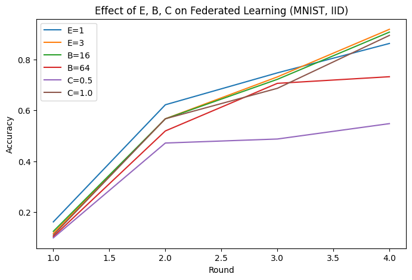
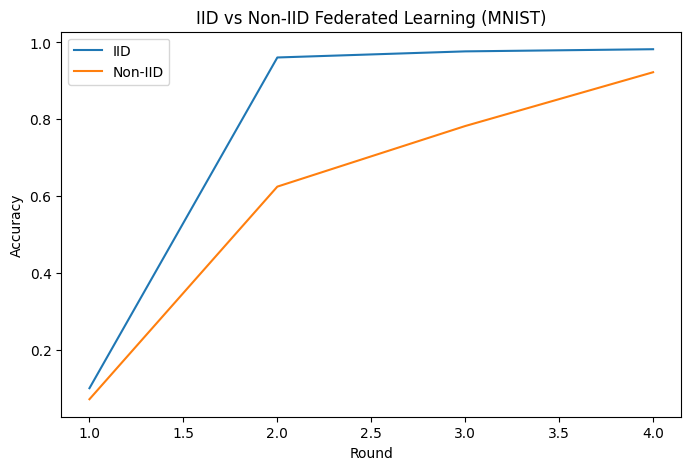

# Federated Learning
# Summary, Code Explanation, and Results

## 1, Short summary of Federated Learning
**Federated Learning (FL)** is a distributed training approach where many clients (devices, organizations) train a shared global model collaboratively **without sending raw data to a central server**. Each client trains locally and sends model updates (weights or gradients) to the server. The server aggregates updates (commonly with **FedAvg**) to produce a new global model.

**Benefits:** privacy (data stays local), reduced raw-data movement, ability to combine models trained on geographically/organizationally separated data.  
**Challenges:** non-IID data distributions across clients, limited communication, device heterogeneity, possible client drift.

---

## 2, The results (plots)

### Effect of E, B, C on Federated Learning (MNIST, NON_IID)

### IID vs Non-IID Federated Learning (MNIST)

---

## 3, What the code does (walkthrough / how it works)

1. **Hyperparameters**  
   `NUM_CLIENTS = 4`, `ROUNDS = 3`, `LR = 0.01`, `LOCAL_EPOCHS`, `BATCH_SIZE`, `CLIENT_FRAC` etc. These control number of clients, training rounds, local training intensity, and how many clients participate each round.

2. **Data loading and partitioning**  
   - Loads MNIST with torchvision.  
   - `iid_partition`: splits dataset randomly and evenly into `NUM_CLIENTS` subsets.  
   - `noniid_partition`: creates label-sorted shards then assigns `shards_per_client` shards to each client — yields label-skewed (non-IID) distributions.

3. **Model**  
   A small CNN (`Net`) with two conv layers and two fully connected layers. Output uses `log_softmax` and training uses `NLLLoss`.

4. **Train & Test helpers**  
   `train(model, trainloader, epochs)` runs local SGD. `test(model, testloader)` computes average loss and overall accuracy.

5. **Flower client implementation (NumPyClient)**  
   - `get_parameters()` returns model state as NumPy arrays.  
   - `set_parameters()` sets local model from server parameters.  
   - `fit()` receives global parameters, sets them, trains locally, and returns updated weights and dataset size.  
   - `evaluate()` sets parameters and returns loss and accuracy on the global test set.

6. **Simulation orchestration (`run_simulation`)**  
   - Starts Flower simulation with `FedAvg` strategy and `evaluate_fn` that loads server parameters into a fresh `Net()` and tests on the test set.  
   - Each time `evaluate_fn` runs it appends the computed accuracy to `acc_list`. That list is returned when simulation ends and used for plotting.

7. **Experiments**  
   - IID vs Non-IID: `run_simulation(iid_data, ...)` vs `run_simulation(noniid_data, ...)`.  
   - Parameter sweeps: vary `E` (local epochs), `B` (batch size), `C` (client fraction) by calling `run_simulation` repeatedly and collecting accuracies.

---

## 4, Why the plots look the way they do (explanations & causes)

### Observed fast convergence to very high accuracy (IID case)
- MNIST is relatively easy for small CNNs. With 4 clients each training on reasonably large local datasets, even **one local epoch** per client plus FedAvg aggregation can produce rapid global improvement.
- Using `CLIENT_FRAC = 1.0` (all clients each round) gives representative, low-variance updates and fast convergence.
- The code evaluates right after aggregation each round; if Flower runs an initial evaluation before training it can add an untrained baseline point (~0.1). After 1–2 rounds aggregated training produces high accuracy.

### Why Non-IID lags behind IID
- **Non-IID means label skew** (clients see different subsets of labels). Local updates optimize for the client’s local distribution, which can be *conflicting* across clients. Averaging conflicting updates slows global convergence and causes instability (client drift).
- In the provided `noniid_partition` each client gets shards concentrated in a few labels → local training biases the model toward those labels and leads to worse global test accuracy until more rounds/aggregation balance the gradients.

---

## 5, Detailed explanation: Effect of E, B, and C

### E -> local epochs (how many local passes each client does)
- **Increasing E** (e.g., 1 → 3):
  - **Pros:** clients perform more local optimization, producing larger updates per communication round; can reduce required communication rounds.
  - **Cons:** on *non-IID* data, large E leads to stronger local overfitting / client drift; averaged updates may conflict and harm convergence.
- **In IID settings:** higher E often helps (reduces communication).  
- **In Non-IID settings:** prefer smaller E or use corrective algorithms (FedProx, SCAFFOLD).

### B -> batch size (local mini-batch for SGD)
- **Smaller B** (e.g., 16):
  - More SGD steps per epoch, *noisier* gradients → often better generalization but slower per-epoch throughput.
- **Larger B** (e.g., 64):
  - Smoother gradients, faster throughput, sometimes slightly worse generalization.
- **Interaction:** B interacts with E — (large E + small B) = many noisy steps → aggressive local updates.

### C -> client fraction (fraction_fit in FedAvg)
- **C = 1.0**: all clients participate every round - aggregated update is representative; low variance; faster/stabler convergence.
- **C = 0.5**: only half clients selected each round - less communication but higher variance in aggregated updates; convergence is slower and noisier.
- **Tradeoff:** lower C reduces communication but typically requires more rounds to converge to the same accuracy.

---

## 6, Additional code-specific notes, pitfalls & quick fixes

1. **Extra evaluation point (num_rounds vs acc_list length)**  
   - Flower may evaluate before training begins. To append only accuracies after training rounds, check `server_round` in `evaluate()` and append only when `server_round > 0`.

2. **Determinism & randomness**  
   - Set seeds (`np.random.seed`, `torch.manual_seed`, `random.seed`) for reproducibility.

3. **Non-IID intensity**  
   - `shards_per_client` in `noniid_partition` controls skew severity, fewer shards per client = more extreme non-IID.

4. **Model & dataset**  
   - Small CNN + MNIST converges quickly. For stronger FL behavior, use more clients, smaller local datasets, or harder tasks.

5. **Algorithms to mitigate non-IID**  
   - Consider **FedProx**, **SCAFFOLD**, or personalization techniques.

---

## 7, Concrete suggestions to improve experiments & plots
- Increase `ROUNDS` (try 20–100) , 3 rounds is too few to analyze convergence.  
- Run multiple seeds and report mean ± std.  
- Change one hyperparameter at a time for clean comparisons.  
- Try different `shards_per_client` values to control non-IID severity.  
- Avoid initial extra evaluation points by filtering on `server_round`.

---

## 8, Quick troubleshooting checklist
- `CLIENT_FRAC=1.0` with small `NUM_CLIENTS` → fast, stable convergence.  
- Non-IID → client drift, slower convergence.  
- High E on Non-IID → divergence risk.  
- Batch size affects gradient noise/stability.

---

